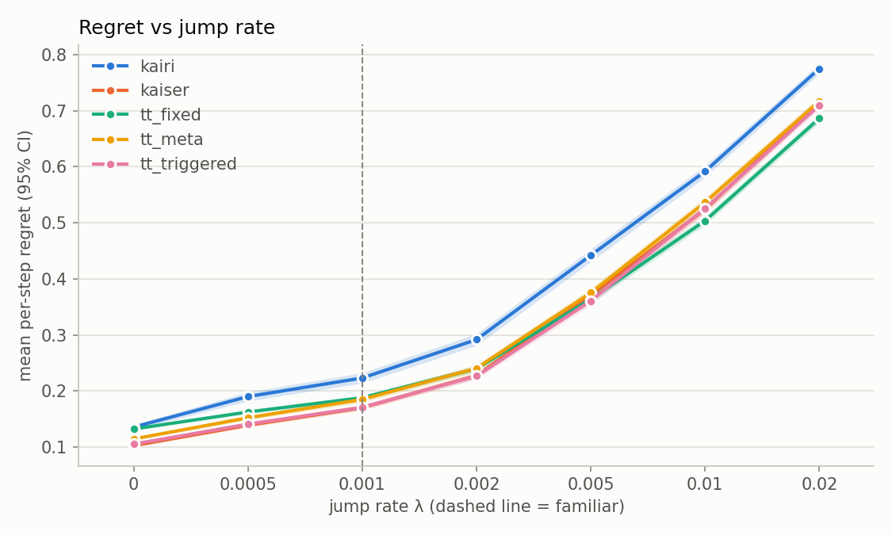
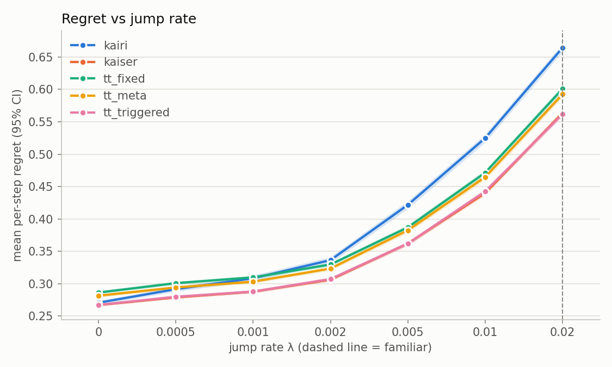
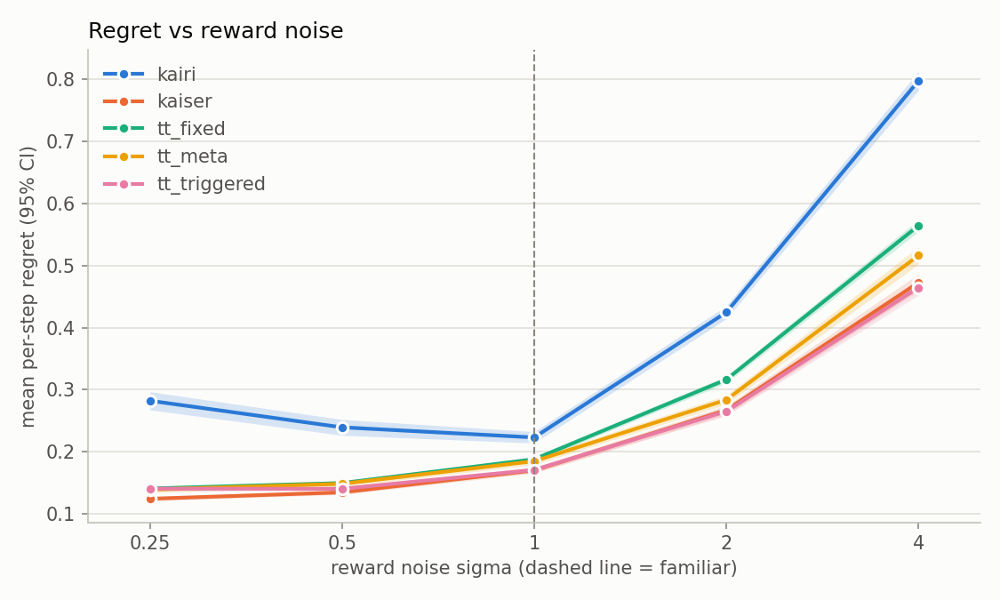
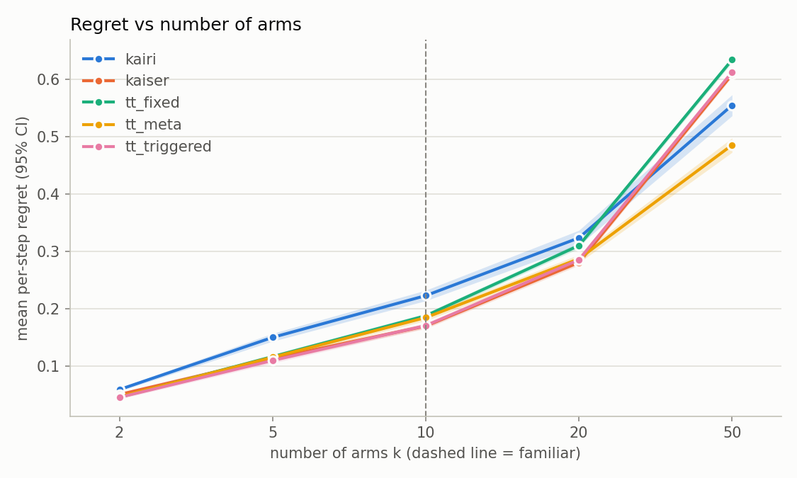
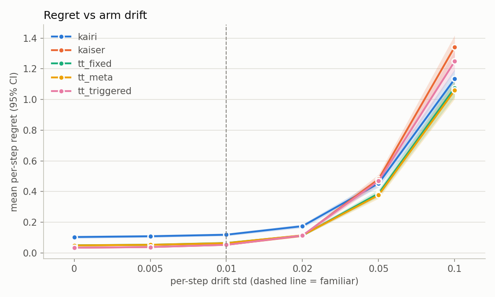
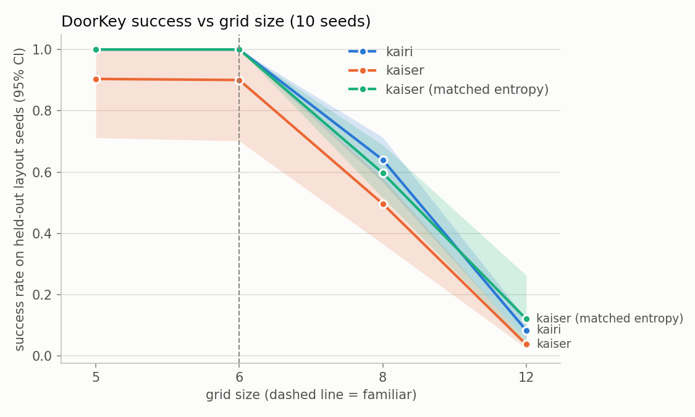

# XP — when does uncertainty-driven exploration pay off?

XP studies the explore-vs-exploit tradeoff by comparing two agents across worlds that shift
progressively away from the conditions they were tuned on.

- **Kairi** — model-free, reward-driven learner (ε-greedy in the bandit, plain PPO in MiniGrid).
- **Kaiser** — Kairi plus an explicit uncertainty-driven exploration term (discounted UCB in the
  bandit, PPO + RND bonus in MiniGrid). Defining principle: optimism in the face of uncertainty.

The output is a map of *when each agent wins and where it breaks*, built on a reusable protocol.
Kairi winning some regimes is a valid result. Design: `docs/superpowers/specs/2026-10-22-xp-design.md`.

## Summary

- **Bandit:** Kaiser (discounted UCB) beats Kairi (epsilon-greedy) at every jump rate, under reversed tuning, and under reward-noise shifts. Kairi wins only when the frozen agents face a world far from
  the tuned point: many more arms than tuned (k = 50 vs 10) and fast arm drift (0.1 vs 0.01). Post-hoc ablations show these wins are tuning brittleness, not a cost of exploration: retuned for the shifted
  world, Kaiser wins at both points.
- **MiniGrid:** on DoorKey the RND bonus gave no measurable benefit, but a post-hoc 5M-step probe on an exploration-heavy MultiRoom level found RND at a large coefficient reaches 95% success in about half the steps of plain PPO (5 seeds; not a protocol result), and a protocol-legal confirmation on that level (tuned, matched entropy, 10 fresh seeds) found Kaiser about 1.5M steps faster, on 10 of 10 seeds (paired CI 0.9M to 2.1M). On DoorKey, Kairi (PPO) looked better at sizes 8 and 12 with the tuned settings, but that gap disappears at other tuning-tied settings and with
  matched entropy (10 seeds), so the supported claim is a tie, not "RND hurts".
- **Map:** the exploration bonus helps in a changing bandit; Kaiser's *tuned settings* are more brittle than Kairi's under large shifts (retune them when the world changes a lot); and RND helps only where exploration is the bottleneck, at a large enough bonus and budget (post-hoc MultiRoom probe), not in the sparse-but-learnable DoorKey.
- Short write-up: `docs/WRITEUP.md`; full analysis with evidence and caveats: `docs/FINDINGS.md`; design: `docs/superpowers/specs/2026-10-22-xp-design.md`.

## Protocol

1. Tune each agent on the familiar knob value, using tune seeds only.
2. Freeze the tuned parameters.
3. Evaluate at every knob value on disjoint eval seeds.
4. Report degradation curves, gaps and crossovers with 95% bootstrap CIs (the independent seed is the
   resampling unit; paired comparisons share eval seeds).

Both agents get equal-sized tuning grids and budgets. A tuned optimum on a grid edge marks the run
`provisional` and it is excluded from final tables. Runs are resumable and keyed by config hash.

## Phase 1 — changing bandit

10-armed Gaussian bandit (σ = 1, horizon 2000) whose best arm jumps at rate λ. Tuned at
λ = 0.001; evaluated at λ ∈ {0, 0.0005, 0.001, 0.002, 0.005, 0.01, 0.02}. 500 tune seeds, 1000 eval
seeds. Metric: regret per step (lower is better). Three tag-team agents (`tt_fixed`, `tt_triggered`,
`tt_meta`) that switch between Kairi and Kaiser are also evaluated.

### Results

- **Kaiser beats Kairi at every jump rate and the curves do not cross.** Kairi − Kaiser regret per step (95% CI):

  | λ | 0 | 0.0005 | 0.001 (familiar) | 0.002 | 0.005 | 0.01 | 0.02 |
  |---|---|---|---|---|---|---|---|
  | diff | 0.033 [0.028, 0.038] | 0.051 [0.044, 0.059] | 0.053 [0.045, 0.061] | 0.064 [0.055, 0.074] | 0.072 [0.061, 0.082] | 0.068 [0.058, 0.078] | 0.060 [0.051, 0.069] |

  All seven intervals exclude 0 (winner: Kaiser each time); Kairi is never best.
- **Degradation from the familiar λ** (regret increase over each agent's own value at λ = 0.001): at λ = 0.02, Kairi +0.552
  [0.540, 0.564], Kaiser +0.546 [0.538, 0.553], `tt_fixed` +0.498 [0.490, 0.506]; at λ = 0.005, Kairi +0.219 [0.206, 0.231]
  vs Kaiser +0.200 [0.193, 0.208]. These CIs are per agent against its own baseline; head-to-head comparisons are the table above.
- `tt_fixed` (fixed 50-step blocks) is worse than Kaiser for λ ≤ 0.002, tied at 0.005, and better
  at 0.01 (−0.020) and 0.02 (−0.029); those CIs exclude 0.
- `tt_meta` never beats Kaiser.
- `tt_triggered` ties Kaiser except one win at λ = 0.005 (−0.0098), likely noise (1 of 21 comparisons).

### Extra shifts (post-hoc, same protocol; `configs/bandit-{reversed,sigma,k,drift}.yaml`, `figs/shifts/`)

Kairi − Kaiser regret per step, paired 95% CI; positive = Kaiser better.

| shift | Kaiser wins | tie | Kairi wins | crossover |
|---|---|---|---|---|
| tuned at λ = 0.02, swept λ 0 to 0.02 | all 7 (0.0035 to 0.101) | none | none | none |
| reward noise σ ∈ {0.25, 0.5, 1, 2, 4} | all 5 (0.053 to 0.325) | none | none | none |
| arms k ∈ {2, 5, 10, 20, 50} | k ≤ 20 (0.009 to 0.053) | none | k = 50 (−0.054 [−0.071, −0.037]) | (20, 50) |
| drift std ∈ {0, 0.005, 0.01, 0.02, 0.05, 0.1}, no jumps | up to 0.02 (0.063 to 0.070) | 0.05 (−0.027 [−0.059, 0.002]) | 0.1 (−0.209 [−0.283, −0.132]) | (0.02, 0.1) |

| tuned at λ = 0.02 | reward noise σ |
|---|---|
|  |  |
| **arms k** | **arm drift** |
|  |  |

Kaiser's advantage is robust to reversing the tuning direction and to reward noise. Kairi wins only at k = 50 and drift 0.1, far from the tuned point. First runs for the reversed and
drift shifts were provisional (grid edges); grids were widened and rerun.

**Ablation (post-hoc, outside the protocol; `docs/FINDINGS.md`, `figs/ablations/`).** Retuning both agents at the shifted point (k = 50, drift = 0.1; `configs/bandit-{k-at50,drift-at01}.yaml`) reverses both Kairi wins:
Kaiser wins at k = 50 by 0.086 [0.070, 0.103] and at drift 0.1 by 0.168 [0.156, 0.179] (Kaiser `gamma` moves from 0.98 to 0.995 at k = 50 and from 1.0 to 0.99 under drift). A regret-over-time split at k = 50
shows Kaiser is ahead through step 500 and loses only afterwards, so the "initial UCB exploration cost grows with k" explanation is not supported. So the Kairi wins reflect Kaiser's frozen tuning being
more brittle, not exploration hurting.

## Phase 2 — MiniGrid DoorKey

PPO (Kairi) vs PPO + RND bonus (Kaiser). Tuned on size 6; evaluated zero-shot at sizes
{5, 6, 8, 12} and few-shot at {8, 12}. Metric: success rate.

### Results

Tuned on size 6 (3 tune seeds): Kairi `ent_coef` = 0.03, Kaiser `rnd_coef` = 0.001; both interior optima
(not provisional). Budget S = 2M steps (the cap; calibration did not reach the 80% target, mean success ~0.67).
10 eval seeds per agent, 200 held-out layouts per size.

| size | Kairi | Kaiser | Kairi − Kaiser (95% CI) |
|---|---|---|---|
| 5 | 1.000 | 0.904 [0.71, 1.00] | 0.096 [0.00, 0.29] (tie) |
| 6 (familiar) | 1.000 | 0.900 [0.70, 1.00] | 0.100 [0.00, 0.30] (tie) |
| 8 | 0.640 [0.57, 0.71] | 0.496 [0.37, 0.58] | 0.143 [0.02, 0.29] (Kairi) |
| 12 | 0.083 [0.05, 0.12] | 0.038 [0.03, 0.05] | 0.046 [0.01, 0.08] (Kairi) |

- **The curves do not cross.** Kairi is at or above Kaiser at every size; with the tuned settings the difference excludes 0 at sizes 8 and 12 (but see the tie-sensitivity check below).
- **Few-shot (200k steps):** size 8, Kairi 1.00 vs Kaiser 0.90 [0.70, 1.00] (paired diff 0.100 [−0.002, 0.300], tie); size 12, Kairi 0.72 [0.44, 0.97] vs
  Kaiser 0.50 [0.23, 0.78] (paired diff 0.215 [0.017, 0.463], Kairi). The size 12 win is not robust: across Kaiser's tuning-tied `rnd_coef` values its few-shot success at size 12 ranges 0.25 to 0.72, and with matched entropy
  it ties (0.73; paired diff −0.016 [−0.085, 0.060]). See "Few-shot across variants" in `docs/FINDINGS.md` (`scripts/fewshot_compare.py`).
- **Sample efficiency (steps to 80% at size 6):** mean Kairi 279k [230k, 328k], Kaiser 543k [271k, 929k], but the Kaiser
  mean is inflated by one censored seed (seed 101 never reached 80% and enters at the 2M cap). Medians are about equal
  (Kairi 261k, Kaiser 246k); seven of ten Kaiser seeds reach 80% by 460k steps. No efficiency difference is claimed.
- **One Kaiser seed fails outright.** Kaiser seed 101 got 0.04 at size 5, 0.00 at size 6 and 0.00 at sizes 8 and 12 (and 0.00
  few-shot at size 8); every other Kaiser seed reached 1.0 at sizes 5 and 6, as did all ten Kairi seeds. That one seed
  explains Kaiser's 0.90 at sizes 5/6 and 0.90 few-shot at size 8. Excluding it, Kaiser is 0.552 at size 8 and 0.042 at size 12
  (still below Kairi's 0.640 and 0.083), so the size 8 and 12 ordering does not depend on that seed. (Post-hoc check,
  not part of the protocol.)

**Sensitivity to the tuning tie (post-hoc, outside the protocol).** Tuning tied three Kaiser settings (`rnd_coef` 0.001, 0.003, 0.01;
all 0.0) and two Kairi settings (`ent_coef` 0.03, 0.1); training AUC broke the ties to 0.001 and 0.03. Rerunning the eval on the
same 10 seeds at the other tied values (`scripts/tie_robustness.py`, `scripts/compare_robustness.py`) shows the size 8/12
advantage depends on that choice. Paired Kairi − Kaiser success (95% CI), Kairi at its tuned 0.03:

| Kaiser `rnd_coef` | size 8 | size 12 |
|---|---|---|
| 0.001 (tuned) | 0.143 [0.020, 0.295] | 0.046 [0.012, 0.082] |
| 0.003 | 0.121 [−0.002, 0.260] | 0.011 [−0.058, 0.063] |
| 0.01 | 0.030 [−0.086, 0.141] | −0.009 [−0.105, 0.052] |

At `rnd_coef` 0.01 Kaiser matches Kairi at every size (1.000, 1.000, 0.610, 0.092 vs Kairi 1.000, 1.000, 0.640, 0.083). With Kairi at its
other tied value (`ent_coef` 0.1: 1.000, 1.000, 0.636, 0.116) the tuned-Kaiser gap is similar (size 8: 0.140 [0.047, 0.239]; size 12:
0.078 [0.019, 0.160]). So the supported statement is: **Kaiser is never better than Kairi anywhere, and is clearly worse at sizes 8 and 12
only for the AUC-selected `rnd_coef`; under other tied settings the two are statistically indistinguishable.** Choosing a variant by its
eval score would not be protocol-legal, so the tuned result stays the headline and this is reported as sensitivity. One Kaiser seed fails
outright in two of the three settings (seed 101 at 0.001, seed 105 at 0.003); none fails at 0.01 or in any Kairi run.

**Matched-entropy check (post-hoc, outside the protocol).** In the main run Kaiser's `ent_coef` is fixed at 0.01 while Kairi tuned 0.03, so Kaiser's
deficit could be an entropy effect. `scripts/entropy_fair.py` with `configs/minigrid-entfair.yaml` sets Kaiser's `ent_coef` to 0.03, re-tunes `rnd_coef`
on the same grid with tune seeds only (five of six values tie at 0.000; the AUC tie-break picks 0.01, not provisional), and evaluates on the same 10 eval
seeds. Kairi is not rerun. Paired Kairi − Kaiser success (95% CI): size 5 and 6, 0.000 (both agents 1.000); size 8, 0.043 [−0.053, 0.142]; size 12,
−0.037 [−0.159, 0.040]. No seed fails outright, and few-shot is about equal (size 8: 1.00 vs 1.00; size 12: 0.72 vs 0.73). With matched entropy Kaiser is
statistically indistinguishable from Kairi at every size, so the tuned-setting deficit above is better read as an entropy/tuning effect than as evidence that RND
hurts. It is not evidence that RND helps either; n = 10 and the size 8/12 intervals are wide.

The tuned-only figure from the protocol report is `figs/degradation.png`; the figure above adds the matched-entropy Kaiser (`scripts/plot_minigrid_robustness.py`).

### Exploration-heavy spike (MultiRoom, post-hoc, outside the protocol)

To check whether RND helps where exploration is the bottleneck, we ran 28 short runs (2 seeds, 2M steps; `scripts/spikes/`, `docs/spikes/multiroom_spike.csv`) of plain PPO and PPO+RND on MultiRoom with 2 to 4 rooms and several room sizes.
RND was never faster at 2M steps (8 of 8 seed-matched pairs where both solved the level), never solved a level plain PPO failed, and cost about 1.2 to 1.8x the time; at the one borderline level (4 rooms of size ≤ 4) plain PPO solved 1 of 2 seeds and RND 0 of 2.

A follow-up probe at that level with a 5M-step budget, 5 seeds, and RND coefficients 0.01, 0.03 and 0.1 (`docs/spikes/multiroom_probe.csv`, `scripts/spikes/probe_summary.py`) changed the picture: plain PPO solves all 5 seeds (median 2.66M steps to 95% training success);
RND at 0.1 solves all 5 in a median 1.44M steps, faster on every seed (mean 1.17M fewer steps, 95% CI [0.53M, 1.75M]); RND at 0.03 is slightly slower (CI just includes 0) and RND at 0.01 is mixed with one failed seed.
So RND helps here, but only at a large enough coefficient and budget. This is post-hoc: three coefficients were tried and the best is reported, 0.1 is the top of the range tried, 5 seeds on tune-pool seeds. It is evidence, not a protocol result.

**Protocol-legal confirmation (2026-10-25).** Same level (4 rooms, size ≤ 4), run through the full protocol: Kairi's `ent_coef` and Kaiser's `rnd_coef` (grid 0.01 to 1.0) tuned on 3 tune seeds by training AUC, Kaiser's entropy matched to Kairi's tuned value, budget S = 2.94M from calibration, 10 disjoint eval seeds. Tuned values: Kairi 0.01, Kaiser 0.6 (both interior, not provisional).
Kaiser reached 95% training success in a mean 0.70M steps against 2.23M for Kairi (difference −1.52M, paired 95% CI [−2.12M, −0.93M]), faster on 10 of 10 seeds; training AUC 0.78 vs 0.26 (+0.52 [+0.31, +0.73]); Kaiser solved 10/10 seeds within the budget, Kairi 5/10.
Caveats: one level; the level and grid were chosen after the probe, so only the eval seeds are fresh; Kairi's failures are budget-limited (S was fit to its tune seeds), so the step and AUC gaps are the robust numbers; steps, not wall-clock, were compared. Full write-up: `docs/MULTIROOM_EVALUATION.md`; data: `docs/spikes/multiroom_confirmation.csv`.

## Limitations

- Phase 1: the `tt_*` agents go beyond the original two-agent design; Kaiser and `tt_triggered` tie at low λ.
- Phase 1 was run on Colab (Python 3.13) and rerun locally (Python 3.9.6, numpy 2.0.2): the `gaps.csv` and `crossovers.csv` tables agree to
  within the 4-decimal rounding of the Colab output (max difference 5e-05), so the results do not depend on the numpy/Python version.
- Phase 2: the calibrated budget is the 2M cap and the 80% calibration target was not reached; one familiar size; one seed pool; PPO hyperparameters are not tuned beyond one coefficient
  per agent; PPO on DoorKey-6 is very seed-dependent, so CIs are wide.
- Phase 2: the tuned-setting advantage of Kairi at sizes 8 and 12 is sensitive to which tied `rnd_coef` the AUC tie-break picks and disappears with matched entropy (see above); 10 eval seeds only, so a small Kaiser effect in either direction cannot be ruled out.
- Phase 2: in the main run Kaiser's `ent_coef` (0.01) was fixed while Kairi's was tuned (0.03), an unequal treatment that the matched-entropy check addresses post-hoc only.
- Phase 2: test layouts at sizes 5 and 6 are held-out seeds, not unseen layouts; size 12 is at the
  floor for zero-shot.

## Where each agent loses

- **Bandit (Phase 1):** over the jump-rate sweep Kairi (epsilon-greedy) is never the best single agent; Kaiser's discounted UCB wins at every jump rate, and only `tt_fixed` beats it, at high lambda (>= 0.01).
  In the extra shifts Kairi wins at k = 50 arms and at drift 0.1 (far beyond the tuned k = 10 / drift 0.01) with frozen settings; retuned at those points, Kaiser wins (ablation above). Kaiser is better everywhere else.
- **MiniGrid (Phase 2):** Kaiser (PPO + RND) never beats plain PPO. It ties at sizes 5 and 6 and, at its tuned setting, loses at 8 and 12, but that loss does not survive
  either robustness check: Kaiser at a different tied `rnd_coef`, or at Kairi's entropy coefficient, is statistically indistinguishable from Kairi at every size (10 seeds).
  The supported conclusion is "no measurable RND benefit on DoorKey", not "RND hurts". RND adds per-step cost (Kaiser seed jobs took ~2.5x as long). A plausible but
  untested reason for no benefit: extrinsic reward is reachable with plain exploration. The agents break down together as size grows (size 12 near the floor).
  MiniGrid DoorKey is closed here (the MultiRoom spike below found no RND benefit at 2M steps; a post-hoc 5M-step probe and then a protocol-legal confirmation found one at a large coefficient on 4 small rooms); a 30-seed rerun with matched entropy was planned and shelved (`docs/superpowers/plans/2026-10-24-phase2-step-a.md`).
- So the exploration bonus helps in the nonstationary bandit; Kaiser's frozen tuned settings break down far from the tuned point (many arms, fast drift) but not once retuned there; and it does not help in this sparse-but-learnable MiniGrid family.

## Future work

Open: the MultiRoom confirmation at other room counts (the 4-room confirmation is done) and a deep-RL tag-team agent. Crafter was spiked (2026-10-26): plain PPO reached only 4.5 distinct achievements per episode at 1M steps, below the pre-set gate of 5, so Crafter is closed as a documented spike with no full phase (`docs/spikes/crafter_spike.md`). We may reconsider it in the future; it was decided against for now because of time. Showdown is specified but not approved for building. A design sketch for Crafter and Showdown (knobs, costs, risks, go/no-go criteria; not approved for building) is in `docs/FUTURE_WORK.md`.

## Repository map

- `xp/protocol/` phase-agnostic protocol (tuner, evaluator, results store); `xp/bandit/` and `xp/minigrid/` the two phases; `xp/stats/`, `xp/plots/` read only the tidy results table.
- `configs/` run configs; `calibration*.json` frozen MiniGrid budgets; `tests/` the fast suite.
- `docs/` write-up (`WRITEUP.md`), full analysis (`FINDINGS.md`), the MultiRoom evaluation, spike data (`docs/spikes/`), the design spec and plans (`docs/superpowers/`).
- `scripts/` post-hoc analyses; `scripts/spikes/` the closed spikes (MultiRoom, Crafter). The Crafter spike needs `pip install crafter` (not in `requirements*.txt`, since no Crafter phase was built).
- `notebooks/` Colab launchers for each phase and the Crafter spike. `figs/` and `results/` are generated; only the figures cited in the docs are tracked.

## Reproducing

See `CLAUDE.md` for commands. Full runs go to Colab (`notebooks/`), Phase 2 may also run locally.
