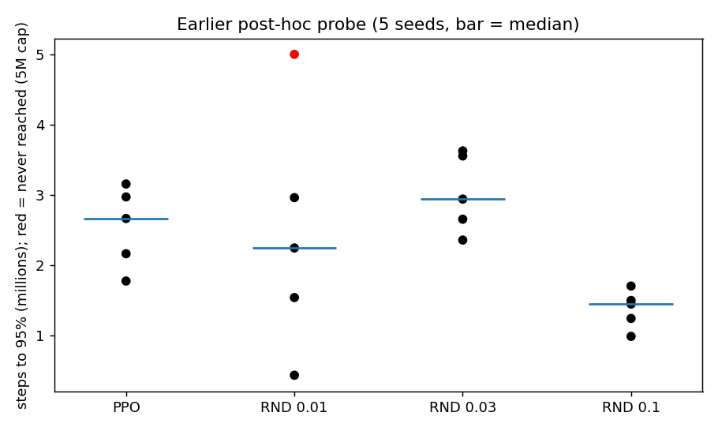
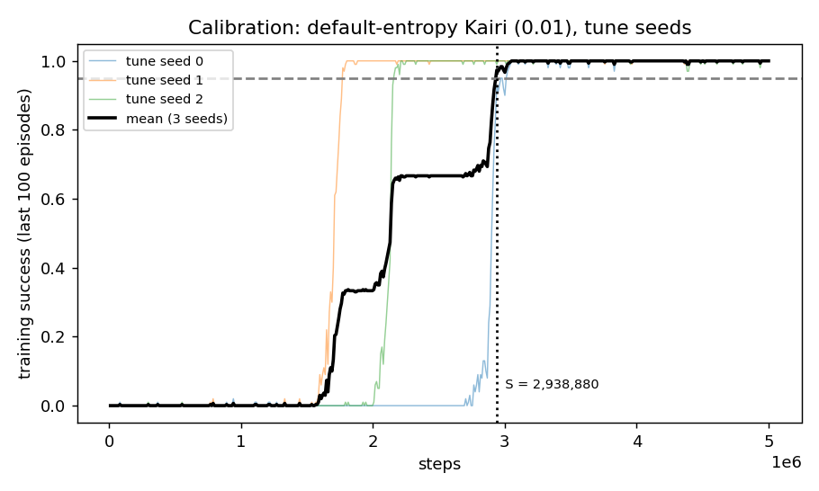
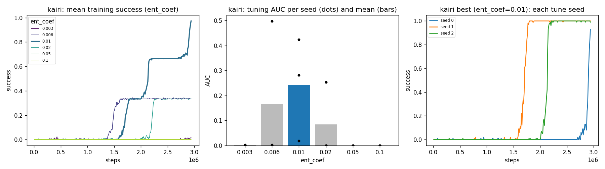

# MultiRoom confirmation: evaluation document

**Status: INTERIM (written 2026-10-25, run in progress).** Calibration and Kairi tuning are done. Kaiser tuning and the 20 evaluation jobs are still running (about 10 more hours). Sections marked **PENDING** are filled in after the run. Everything else is final.

Binding design: `docs/superpowers/specs/2026-10-22-xp-design.md`, section 5.4. Plan: `docs/superpowers/plans/2026-10-25-multiroom-confirmation.md`.
Figures are made by `scripts/multiroom_eval_figs.py` (rerun it any time; it draws whatever exists).

---

## 1. The question

Kairi is plain PPO. Kaiser is PPO plus an RND exploration bonus ("optimism in the face of uncertainty").
On DoorKey, Kaiser never helped. An earlier **post-hoc** probe on MultiRoom (4 rooms) suggested RND with coefficient 0.1 reaches 95% success in about half the steps of PPO. That probe broke the protocol: the level and coefficients were picked after looking, and the coefficient grid was tried on the same seeds.

This run asks: **does Kaiser learn faster than Kairi on MultiRoom, 4 rooms, when both are tuned and evaluated under the full protocol?** A Kairi tie or win is a valid answer.

### The earlier probe (context, not evidence)



Each dot is one seed's steps to 95% success. PPO median 2.66M; RND 0.1 median 1.44M and faster on 5 of 5 seeds; RND 0.01 and 0.03 no better than PPO. Red = never reached within 5M. The probe is suggestive only: it picked the best of three coefficients, at the top of the range, on seeds that overlap this run's tuning seeds.

## 2. Protocol (what makes this a legal test)

| Step | What is done |
|---|---|
| Level | MultiRoom, 4 rooms, max room size 4 (one familiar level, no knob sweep) |
| Tune | 3 tune seeds (0, 1, 2), one grid per agent, equal grid sizes (6 values each) |
| Objective | Training AUC of success: mean of `success_100` over the whole training curve (higher is better). Minimised as 1 − AUC |
| Freeze | Winning values are fixed before any eval seed is touched |
| Evaluate | 10 eval seeds (100 to 109), disjoint from tune seeds (enforced; violating raises `ProtocolError`) |
| Metrics | AUC (primary), steps to 95%, whether 95% was reached, held-out success on 200 test layouts |
| Statistics | Paired bootstrap 95% CIs, resampling seeds |
| Edge rule | A tuned value on a grid edge makes the run provisional (widen and rerun) |
| Tie-break | Lowest mean steps to 95% (censored at the budget), then grid order |

**Matched entropy.** Kairi is tuned first (`ent_coef` in 0.003, 0.006, 0.01, 0.02, 0.05, 0.1). Kaiser then uses **Kairi's tuned `ent_coef`** and tunes only `rnd_coef` (0.01, 0.03, 0.1, 0.3, 0.6, 1.0). That way a Kaiser win cannot be an entropy effect. (On DoorKey, unmatched entropy fooled us once.)

**Known limitations (state these when quoting results):**
1. The level, target and grid range were chosen *after* the probe. Only the eval seeds (100+) are fresh.
2. Tune seeds 0 to 2 overlap the probe seeds 0 to 4.
3. "Test layouts" are held-out layout seeds, not a different kind of level.
4. One level only: this says nothing about other MultiRoom sizes.

## 3. Budget calibration (done)

The training budget S is not guessed. Default-entropy Kairi (0.01) was trained on the tune seeds, and S is the first logged step where mean training success reaches 95% (capped at 5M).



**Result: S = 2,938,880 steps; the 5M cap was not hit.** It is frozen in `configs/minigrid-multiroom.yaml` (commit `32e41e2`).

How to read it: thin lines are the three tune seeds, black is their mean, dashed is 95%, dotted is S. The seeds are all-or-nothing: each one sits at zero, then jumps to about 1.0 within a few hundred thousand steps. Seed 1 jumps near 1.6M, seed 2 near 2.1M, seed 0 only near 2.8M. The mean therefore climbs in three steps (about 0.33, 0.67, 1.0), and S lands right at the third.

**Consequence you should know about:** S is, by construction, "just long enough for default Kairi". Everything is truncated at S. A setting that learns after S (or never) scores zero for that seed. This is by design but it means the AUC numbers are low in absolute terms.

## 4. Kairi tuning (done)



*(The Kaiser row appears in this figure once Kaiser tuning has run; regenerate to see it.)*

How to read it:
- **Left:** mean training success vs steps, one line per `ent_coef` (thick = winner).
- **Middle:** the tuning score. Bars are the mean AUC over 3 seeds, dots are the individual seeds, blue is the winner.
- **Right:** the winner's three seeds individually.

Per-seed AUC (and steps to 95% where reached):

| ent_coef | seed 0 | seed 1 | seed 2 | mean AUC | seeds reaching 95% |
|---|---|---|---|---|---|
| 0.003 | 0.000 | 0.002 | 0.000 | 0.001 | 0 of 3 |
| 0.006 | 0.000 | 0.497 (1.61M) | 0.003 | 0.167 | 1 of 3 |
| **0.01** | 0.018 | 0.423 (1.77M) | 0.281 (2.16M) | **0.241** | 2 of 3 (seed 0 reaches ~0.93 at S) |
| 0.02 | 0.254 (2.25M) | 0.000 | 0.000 | 0.085 | 1 of 3 |
| 0.05 | 0.000 | 0.000 | 0.000 | 0.000 | 0 of 3 |
| 0.1 | 0.000 | 0.000 | 0.000 | 0.000 | 0 of 3 |

**Result: Kairi `ent_coef` = 0.01, an interior point (not a grid edge), so the run is not provisional.** Score (1 − AUC) 0.759.

### Is an AUC below 0.25 a problem?

No. AUC here is measured up to S, and S was set to where default Kairi barely finishes, so most of the window is the flat zero before take-off. Even a good agent scores far below 1. The score is only meaningful relative to other grid points (and, later, to Kaiser).

### Two honest caveats about this tuning

1. **Noisy.** With 3 seeds and all-or-nothing outcomes, the ranking turns on a few take-off times. 0.006 has the single best seed (0.497), and 0.01 wins mainly because two seeds took off. A different seed set might choose 0.006 or 0.02. The protocol fixes the seeds in advance, so this is not a validity error, but treat "0.01" as a reasonable choice, not a precise optimum. Kaiser inherits this entropy.
2. **0.01 is slightly favoured by construction.** S was calibrated on 0.01's own curve (the same seeds and settings), so the budget is cut exactly where 0.01 finishes. Other entropy values are truncated at a point that suits them less. This effect is likely small, because 0.006 and 0.02 stall at 0.33 rather than just finishing late, but it is real and should be reported.

## 5. Kaiser tuning — PENDING

Expected content: AUC per `rnd_coef` in 0.01 to 1.0, with entropy matched to 0.01, the winner, and whether it sits on an edge.
Risk to check: a winner at 1.0 makes the run provisional (the probe never tried above 0.1), so it would need a widened grid and a rerun.

## 6. Evaluation on fresh seeds — PENDING

Expected content, all paired by seed across Kairi and Kaiser (10 eval seeds, 100 to 109):

| Metric | What it tells us |
|---|---|
| Training AUC | Overall learning speed (the metric we tuned on) |
| Steps to 95% (censored at S) | Speed to solve; the probe's headline metric |
| Seeds reaching 95% | Reliability; failures matter, not just medians |
| Held-out success (200 test layouts) | Does the learned policy generalise to unseen layouts |

Figure `figs/multiroom/eval_curves.png` (success vs steps, thin lines = seeds, thick = mean) and the standard report table (`python -m xp.report --phase minigrid --config configs/minigrid-multiroom.yaml --out results/multiroom --figs figs/multiroom`, no `--allow-provisional`).

## 7. How to read the final answer — PENDING

Decision rule written down before the result:
- **Kaiser better:** the paired CI for (Kairi − Kaiser) steps to 95% excludes zero in Kaiser's favour. Then we say RND helped here under the full protocol, with the limitations in section 2.
- **Tie:** the CI includes zero. Report as "no detectable benefit", and say how wide the CI is.
- **Kairi better:** report it plainly.

A result is **never** upgraded because it matches the probe, and the tuned values are never revisited after seeing eval results.

## 8. How to rerun / regenerate

```bash
# run (resumable; use the same --out and worktree on resume)
caffeinate -i python -m xp.run --phase minigrid --config configs/minigrid-multiroom.yaml --out results/multiroom --workers 3
# figures for this document
python scripts/multiroom_eval_figs.py --run results/multiroom --out figs/multiroom
# standard report
python -m xp.report --phase minigrid --config configs/minigrid-multiroom.yaml --out results/multiroom --figs figs/multiroom
```

Files: `configs/minigrid-multiroom.yaml` (frozen S), `calibration-multiroom.json`, `results/multiroom/minigrid/` (tuning jobs, per-seed curve sidecars), `docs/spikes/multiroom_probe.csv`.
