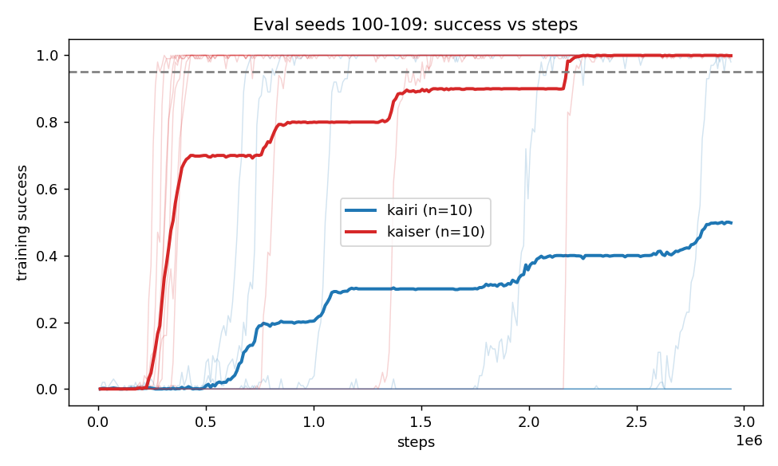

# MultiRoom confirmation: evaluation document

**Status: COMPLETE (2026-10-25).** All 20 evaluation jobs finished; the run is not provisional (no tuned value on a grid edge).

**Headline:** under the full protocol, Kaiser (PPO + RND, `rnd_coef` 0.6) learned MultiRoom (4 rooms) much faster than Kairi (plain PPO, `ent_coef` 0.01): faster on all 10 of 10 fresh eval seeds, about 1.5M fewer steps to 95% success (paired 95% CI 0.9M to 2.1M), and 10/10 seeds solved against 5/10 for Kairi within the budget. Read section 7 for what this does and does not show.

Binding design: `docs/superpowers/specs/2026-10-22-xp-design.md`, section 5.4. Plan: `docs/superpowers/plans/2026-10-25-multiroom-confirmation.md`.
Figures are made by `scripts/multiroom_eval_figs.py` (rerun it any time; it draws whatever exists).

---

## 1. The question

Kairi is plain PPO. Kaiser is PPO plus an RND exploration bonus ("optimism in the face of uncertainty").
On DoorKey, Kaiser never helped. An earlier **post-hoc** probe on MultiRoom (4 rooms) suggested RND with coefficient 0.1 reaches 95% success in about half the steps of PPO. That probe broke the protocol: the level and coefficients were picked after looking, and the coefficient grid was tried on the same seeds.

This run asks: **does Kaiser learn faster than Kairi on MultiRoom, 4 rooms, when both are tuned and evaluated under the full protocol?** A Kairi tie or win is a valid answer.

### The earlier probe (context, not evidence)


Each dot is one seed's steps to 95% success. PPO median 2.66M; RND 0.1 median 1.44M and faster on 5 of 5 seeds; RND 0.01 and 0.03 no better than PPO. Red = never reached within 5M. The probe is suggestive only: it picked the best of three coefficients, at the top of the range, on seeds that overlap this run's tuning seeds.

## 2. Protocol (what makes this a legal test)

| Step | What is done |
|---|---|
| Level | MultiRoom, 4 rooms, max room size 4 (one familiar level, no knob sweep) |
| Tune | 3 tune seeds (0, 1, 2), one grid per agent, equal grid sizes (6 values each) |
| Objective | Training AUC of success: mean of `success_100` over the whole training curve (higher is better). Minimised as 1 − AUC |
| Freeze | Winning values are fixed before any eval seed is touched |
| Evaluate | 10 eval seeds (100 to 109), disjoint from tune seeds (enforced; violating raises `ProtocolError`) |
| Metrics | AUC (primary), steps to 95%, whether 95% was reached, held-out success on 200 test layouts |
| Statistics | Paired bootstrap 95% CIs, resampling seeds |
| Edge rule | A tuned value on a grid edge makes the run provisional (widen and rerun) |
| Tie-break | Lowest mean steps to 95% (censored at the budget), then grid order |

**Matched entropy.** Kairi is tuned first (`ent_coef` in 0.003, 0.006, 0.01, 0.02, 0.05, 0.1). Kaiser then uses **Kairi's tuned `ent_coef`** and tunes only `rnd_coef` (0.01, 0.03, 0.1, 0.3, 0.6, 1.0). That way a Kaiser win cannot be an entropy effect. (On DoorKey, unmatched entropy fooled us once.)

**Known limitations (state these when quoting results):**
1. The level, target and grid range were chosen *after* the probe. Only the eval seeds (100+) are fresh.
2. Tune seeds 0 to 2 overlap the probe seeds 0 to 4.
3. "Test layouts" are held-out layout seeds, not a different kind of level.
4. One level only: this says nothing about other MultiRoom sizes.

## 3. Budget calibration (done)

The training budget S is not guessed. Default-entropy Kairi (0.01) was trained on the tune seeds, and S is the first logged step where mean training success reaches 95% (capped at 5M).


**Result: S = 2,938,880 steps; the 5M cap was not hit.** It is frozen in `configs/minigrid-multiroom.yaml` (commit `32e41e2`).

How to read it: thin lines are the three tune seeds, black is their mean, dashed is 95%, dotted is S. The seeds are all-or-nothing: each one sits at zero, then jumps to about 1.0 within a few hundred thousand steps. Seed 1 jumps near 1.6M, seed 2 near 2.1M, seed 0 only near 2.8M. The mean therefore climbs in three steps (about 0.33, 0.67, 1.0), and S lands right at the third.

**Consequence you should know about:** S is, by construction, "just long enough for default Kairi". Everything is truncated at S. A setting that learns after S (or never) scores zero for that seed. This is by design but it means the AUC numbers are low in absolute terms.

## 4. Kairi tuning (done)


How to read it:
- **Left:** mean training success vs steps, one line per `ent_coef` (thick = winner).
- **Middle:** the tuning score. Bars are the mean AUC over 3 seeds, dots are the individual seeds, blue is the winner.
- **Right:** the winner's three seeds individually.

Per-seed AUC (and steps to 95% where reached):

| ent_coef | seed 0 | seed 1 | seed 2 | mean AUC | seeds reaching 95% |
|---|---|---|---|---|---|
| 0.003 | 0.000 | 0.002 | 0.000 | 0.001 | 0 of 3 |
| 0.006 | 0.000 | 0.497 (1.61M) | 0.003 | 0.167 | 1 of 3 |
| **0.01** | 0.018 | 0.423 (1.77M) | 0.281 (2.16M) | **0.241** | 2 of 3 (seed 0 reaches ~0.93 at S) |
| 0.02 | 0.254 (2.25M) | 0.000 | 0.000 | 0.085 | 1 of 3 |
| 0.05 | 0.000 | 0.000 | 0.000 | 0.000 | 0 of 3 |
| 0.1 | 0.000 | 0.000 | 0.000 | 0.000 | 0 of 3 |

**Result: Kairi `ent_coef` = 0.01, an interior point (not a grid edge), so the run is not provisional.** Score (1 − AUC) 0.759.

### Is an AUC below 0.25 a problem?

No. AUC here is measured up to S, and S was set to where default Kairi barely finishes, so most of the window is the flat zero before take-off. Even a good agent scores far below 1. The score is only meaningful relative to other grid points (and, later, to Kaiser).

### Two honest caveats about this tuning

1. **Noisy.** With 3 seeds and all-or-nothing outcomes, the ranking turns on a few take-off times. 0.006 has the single best seed (0.497), and 0.01 wins mainly because two seeds took off. A different seed set might choose 0.006 or 0.02. The protocol fixes the seeds in advance, so this is not a validity error, but treat "0.01" as a reasonable choice, not a precise optimum. Kaiser inherits this entropy.
2. **0.01 is slightly favoured by construction.** S was calibrated on 0.01's own curve (the same seeds and settings), so the budget is cut exactly where 0.01 finishes. Other entropy values are truncated at a point that suits them less. This effect is likely small, because 0.006 and 0.02 stall at 0.33 rather than just finishing late, but it is real and should be reported.

## 5. Kaiser tuning (done)

Entropy matched to Kairi's tuned 0.01. The top row of the tuning figure in section 4 is Kairi, the bottom row is Kaiser.

| rnd_coef | seed 0 | seed 1 | seed 2 | mean AUC |
|---|---|---|---|---|
| 0.01 | 0.277 | 0.508 | 0.884 | 0.556 |
| 0.03 | 0.111 | 0.020 | 0.228 | 0.120 |
| 0.1 | 0.506 | 0.449 | 0.618 | 0.524 |
| 0.3 | 0.892 | 0.466 | 0.896 | 0.751 |
| **0.6** | 0.865 | 0.899 | 0.903 | **0.889** |
| 1.0 | 0.915 | 0.823 | 0.919 | 0.886 |

**Result: `rnd_coef` = 0.6, an interior grid point (not provisional).** 1.0 is within noise of it (0.886 vs 0.889), so 0.6 is a reasonable choice rather than a sharp optimum. Larger coefficients all learn fast (all three tune seeds reach 95% by about 0.3 to 0.6M steps); small ones (0.01, 0.03) are erratic. The tuning score is on the same seeds used to choose, so on its own it is not a result.

## 6. Evaluation on fresh seeds (done)

10 eval seeds (100 to 109), never used in tuning. Paired by seed. Steps to 95% is censored at S (a seed that never reaches 95% counts as S).



Thin lines are individual seeds, thick lines the mean. Kaiser (red) mostly takes off between 0.25M and 0.5M steps; Kairi (blue) takes off anywhere from 0.7M to past the budget, and 5 of 10 seeds never reach 95% by S. The staircase shape of the means is just seeds jumping one at a time.

| Metric | Kairi mean | Kaiser mean | Kaiser − Kairi, 95% paired CI | Kaiser better on |
|---|---|---|---|---|
| Training AUC (primary) | 0.258 | 0.778 | **+0.520 [+0.312, +0.728]** | 10/10 seeds |
| Steps to 95% (censored at S) | 2.23M | 0.70M | **−1.52M [−2.12M, −0.93M]** | 10/10 seeds |
| Seeds reaching 95% by S | 5/10 | 10/10 | +0.50 [+0.20, +0.80] | 5 seeds (rest tied) |
| Held-out success, 200 test layouts | 0.50 | 1.00 | +0.50 [+0.20, +0.80] | 6 seeds (rest tied) |

Per-seed values: `docs/spikes/multiroom_confirmation.csv` (from `scripts/multiroom_paired.py`). Standard report figure: `figs/multiroom/degradation.png`.

Detail worth knowing:
- **Kaiser is not uniformly fast.** Seed 102 needed 2.22M steps and seed 101 1.43M; the other eight needed 0.28M to 0.87M.
- **Kairi's failures are budget failures, not impossibility.** The earlier probe saw plain PPO reach 95% on all 5 seeds by 3.15M steps. S (2.94M) was calibrated on the three tune seeds, and 5 of 10 eval seeds simply took longer. So the "5/10 vs 10/10" and the success rows depend on S; the steps and AUC rows are the more robust comparisons, and the steps gap is a *lower bound* (censoring caps Kairi's failures at S).
- **Held-out success is almost the same as "reached 95%"** because each agent either solves the level or does not; neither generalises partially.

## 7. What this does and does not show

**Supported (under the protocol):** with entropy matched and each agent tuned on separate seeds, an RND bonus makes PPO learn MultiRoom with 4 small rooms substantially faster and more reliably than plain PPO. The effect is large relative to seed noise: all 10 eval seeds agree in direction, and the paired CIs for AUC and steps exclude zero. This is the first confirmed Kaiser advantage in MiniGrid and agrees in direction (but is larger than) the earlier post-hoc probe.

**Not shown:**
1. **Only one level.** It says nothing about other room counts or about DoorKey (where there was no benefit).
2. **The design was chosen after seeing the probe** (level, target, coefficient range). Only the eval seeds are fresh, so this is a confirmation with a known forking path, not an independent discovery.
3. **Budget-dependent absolute numbers.** S was fit to Kairi's tune seeds, so Kairi's "reached 95%" and success rates would rise with a longer budget. The speed advantage (steps to 95%, AUC) is the robust finding, and the speed gap would only shrink if Kairi kept improving on its failed seeds.
4. **Cost not compared.** RND adds per-step compute; steps are not wall-clock. Earlier work saw Kaiser jobs take about 1.2 to 2.5x as long.
5. **Entropy is Kairi's tuned 0.01, itself a noisy pick from 3 seeds** (section 4). Both agents share it, so it cannot explain the difference, but a different shared entropy could change the size of the gap.

**Decision rule check:** the paired CI for (Kairi − Kaiser) steps to 95% excludes zero in Kaiser's favour, so by the rule fixed in advance this is "Kaiser better" on this level.

## 8. How to rerun / regenerate

```bash
# run (resumable; use the same --out and worktree on resume)
caffeinate -i python -m xp.run --phase minigrid --config configs/minigrid-multiroom.yaml --out results/multiroom --workers 3
# standard report
python -m xp.report --phase minigrid --config configs/minigrid-multiroom.yaml --out results/multiroom --figs figs/multiroom
# figures and paired statistics for this document
python scripts/multiroom_eval_figs.py --run results/multiroom --out figs/multiroom
python scripts/multiroom_paired.py --run results/multiroom --csv docs/spikes/multiroom_confirmation.csv
```

Files: `configs/minigrid-multiroom.yaml` (frozen S), `calibration-multiroom.json`, `results/multiroom/minigrid/` (git-ignored: tuning jobs, per-seed curves), `docs/spikes/multiroom_probe.csv`, `docs/spikes/multiroom_confirmation.csv`.
